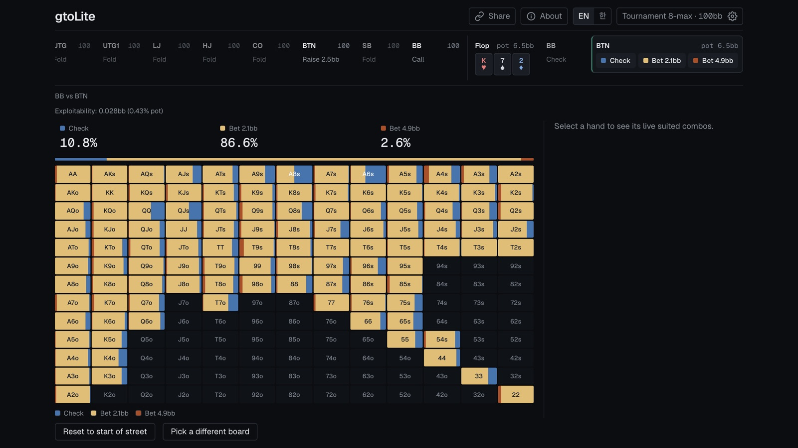

[English](README.md) | **한국어**

# gtoLite

브라우저에서 보는 포커 레인지와 포스트플랍 솔버. 무료 오픈소스이고 가입이 필요 없습니다.

**바로 써 보기: [gto-lite-beryl.vercel.app/ko](https://gto-lite-beryl.vercel.app/ko)** · [프리플랍 레인지 차트](https://gto-lite-beryl.vercel.app/ko/ranges)



## 왜 gtoLite인가

요즘 포커는 솔버로 공부합니다. 그런데 좋은 솔버는 유료이고, 대부분 설치나 가입을 해야 레인지 하나를 볼 수 있습니다. gtoLite는 브라우저 탭에서 열리고 몇 초 안에 답을 줍니다.

완전한 솔버를 대신하지는 않습니다. 속도와 편의를 위해 정확도를 조금 내주고, 얼마나 내줬는지 밝힙니다.

## 기능

- **프리플랍 레인지**: 토너먼트 8인, 캐시 6인·8인, 스택 2~100bb. 각 좌석 아래의 액션을 눌러 핸드를 진행하면, 13×13 표에 핸드마다 폴드, 콜, 레이즈, 올인을 얼마나 하는지 나옵니다.
- **ICM**: 토너먼트 초반부터 파이널 테이블까지 여섯 단계.
- **레이크**: 온라인 저스테이크부터 라이브까지의 캐시 게임 프리셋.
- **포스트플랍 솔브**: 두 명이 남으면 플랍을 고릅니다. WebAssembly로 만든 CFR 솔버가 사용자의 기기에서 두 플레이어의 전략을 계산하고, 턴과 리버도 같은 방식으로 이어집니다.
- **AI 설명**: 끝난 핸드를 그 핸드의 솔버 수치로 설명합니다(한 사람당 하루 3회).
- **공유 링크**: 주소가 항상 화면의 스팟을 담습니다.
- 영어와 한국어.

## 속도와 정확도

| | 결과 | 비교 기준 |
| :-- | :-- | :-- |
| **플랍 솔브 시간** | 약 10초 | 10코어 노트북(Apple M4)의 Chrome |
| **플랍 솔브 손실** | 팟의 1.7% (0.2~2.5%) | 후보 벳 사이즈를 모두 넣고 트리 전체를 푼 결과, 스팟 7개 |
| **빠른 플랍 손실** | 팟의 3.3% (0.9~6.6%) | 위와 같음 |
| **프리플랍 오픈** | 핸드의 87~94%가 일치 | 공개 솔버 레인지와 핸드별 비교 |
| **프리플랍 오픈 대응** | 85~89% | 위와 같음 |
| **프리플랍 3벳 대응** | 73~75% | 위와 같음 |

이를 위해 단순화한 것:

- 프리플랍 레인지는 대부분 **추정치**입니다. 차트와 규칙을 20, 40, 100bb의 솔버 빈도에 맞춰 조정했습니다. 15bb 이하는 올인 아니면 폴드인 게임을 정확히 푼 내시 균형입니다.
- 포스트플랍은 더 작은 게임을 실제로 풉니다: 2명만, 짧은 벳 사이즈 메뉴, 스트리트당 레이즈 한 번.
- 테이블의 모든 플레이어가 같은 스택을 갖습니다.

자세한 내용은 [소개 페이지](https://gto-lite-beryl.vercel.app/about)에 있습니다.

## 개발

```bash
npm install
npm run dev     # http://localhost:3000
npm run test
npm run lint
```

AI 설명을 뺀 모든 기능은 설정 없이 동작합니다. AI 설명에는 `.env.local`에 `KV_REST_API_URL`, `KV_REST_API_TOKEN`(Upstash Redis), `EXPLAIN_SECRET`, `ANTHROPIC_API_KEY`가 있어야 합니다.

포스트플랍 솔버는 C++(`native/solver/`)이고 컴파일된 WebAssembly가 커밋돼 있어서, 따로 빌드할 필요가 없습니다.

## 라이선스

[AGPL-3.0](LICENSE). 자유롭게 사용·수정·재배포할 수 있습니다. 수정본을 배포하거나 네트워크 서비스로 운영하면, 그 소스를 같은 라이선스로 공개해야 합니다.

gtoLite는 학습을 위한 개인 프로젝트이며, 어떤 포커 사이트나 솔버 회사와도 관계가 없습니다.
