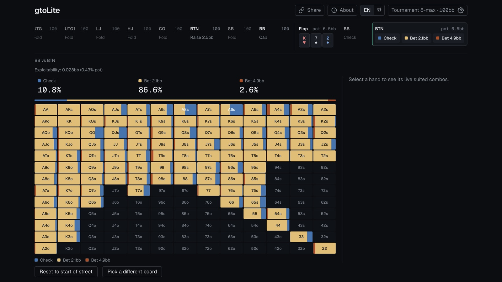

**English** | [한국어](README.ko.md)

# gtoLite

Poker ranges and a postflop solver in your browser. Free and open source, no sign-up.

**Try it: [gto-lite-beryl.vercel.app](https://gto-lite-beryl.vercel.app)**



## Why gtoLite?

Solvers are how poker is studied now, but the good ones cost money, and most need an install or a sign-up before you see a single range. gtoLite opens in a browser tab and answers in seconds.

It does not replace a full solver. It trades some accuracy for speed and ease, and says how much.

## Features

- **Preflop ranges** for tournament 8-max and cash 6-max / 8-max, at any stack from 2 to 100 big blinds. Click an action under each seat to play the hand forward; the 13×13 chart shows how often each hand folds, calls, raises or goes all-in.
- **ICM** for tournaments, at six stages from early play to the final table.
- **Rake** presets for cash games, from online micro-stakes to live.
- **Postflop solving** once two players are left: pick a flop, and a CFR solver compiled to WebAssembly works out both strategies on your device. The turn and river continue the same way.
- **AI explanation** of a finished hand, written from that hand's solver numbers (3 a day per person).
- **Share links**: the address always describes the spot on screen.
- English and Korean.

## Speed and accuracy

| | Result | Measured against |
| :-- | :-- | :-- |
| **Flop solve time** | about 10 s | Chrome on a 10-core laptop (Apple M4) |
| **Flop solve, loss** | 1.7% of the pot (0.2–2.5%) | a solve of the complete tree with every candidate bet size, seven spots |
| **Fast flop, loss** | 3.3% of the pot (0.9–6.6%) | the same |
| **Preflop opens** | 87–94% of hands agree | public solver ranges, hand by hand |
| **Preflop facing an open** | 85–89% | the same |
| **Preflop facing a 3-bet** | 73–75% | the same |

What is simplified to get there:

- Most preflop ranges are **estimates**: charts and rules tuned to solver frequencies at 20, 40 and 100bb. At 15bb or less they are an exact all-in-or-fold Nash solve.
- Postflop is a real solve of a smaller game: heads-up only, a short menu of bet sizes, one raise per street.
- Everyone at the table has the same stack.

The [About page](https://gto-lite-beryl.vercel.app/about) has the full account.

## Development

```bash
npm install
npm run dev     # http://localhost:3000
npm run test
npm run lint
```

Everything except the AI explanation works with no configuration. The explanation needs `KV_REST_API_URL`, `KV_REST_API_TOKEN` (Upstash Redis), `EXPLAIN_SECRET` and `ANTHROPIC_API_KEY` in `.env.local`.

The postflop solver is C++ (`native/solver/`) and its compiled WebAssembly is committed, so no extra build step is needed.

## License

[AGPL-3.0](LICENSE). You may use, modify and redistribute the code; if you distribute a modified version or run one as a network service, you must publish its source under the same license.

gtoLite is an independent study project, not affiliated with any poker site or solver company.
